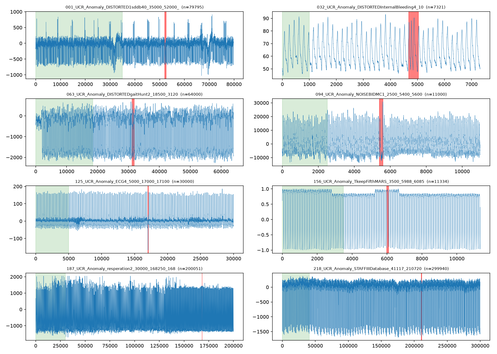
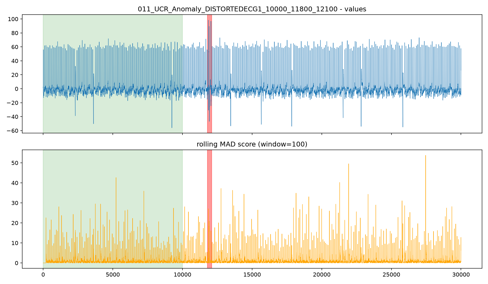
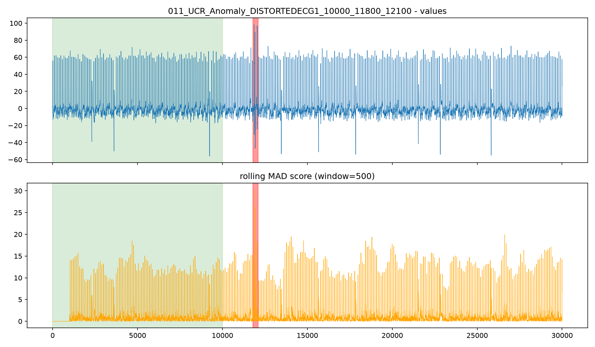

# SignalSleuth

SignalSleuth is a project I'm currently working on to explore time-series anomaly detection using Python.

The main idea is to study how we can detect unusual patterns in data and how different evaluation methods affect the results.
## Evaluation Strategy

SignalSleuth investigates how evaluation choices affect time-series anomaly detection results.

- Compare point-wise Precision, Recall, and F1 with and without Point Adjustment (PA).
- Evaluate detected anomalous events and separate false alarms.
- Select detection thresholds using training or calibration data to avoid data leakage.
- Compare the proposed approach against a simple baseline.

These methods are under investigation; no performance claims are made until experiments are completed.
## What I'm Working On

- Exploring ways to detect unusual patterns in time-series data.
- Testing a shape-based approach to anomaly detection.
- Studying how to choose detection thresholds using training data.
- Looking into how uncertain predictions can be handled.
- Comparing evaluation results with and without Point Adjustment (PA).
- Testing the approach against a simple baseline.

## Tools

- Python
- SQL
- Machine Learning
- Data Analysis

## Project Structure

- `src/` — Main project code
- `tests/` — Tests
- `scripts/` — Scripts for running experiments
- `figures/` — Plots and visualizations
- `reports/` — Experiment notes and results
## Installation

Clone the repository:

```bash
git clone https://github.com/ZEyad69/SignalSleuth.git
cd SignalSleuth
```

Install the dependencies:

```bash
python -m pip install -r requirements.txt
```

## Running Tests

Run the test suite with:

```bash
python -m pytest -v
```

## Visualizations

The plots below show examples from the current experiments.

### Overview


### Anomaly Scores




## Current Status

I'm still working on the implementation and experiments. The methods and evaluation process may change as I learn more and test different approaches.

I'll add the results and findings here as the project progresses.

