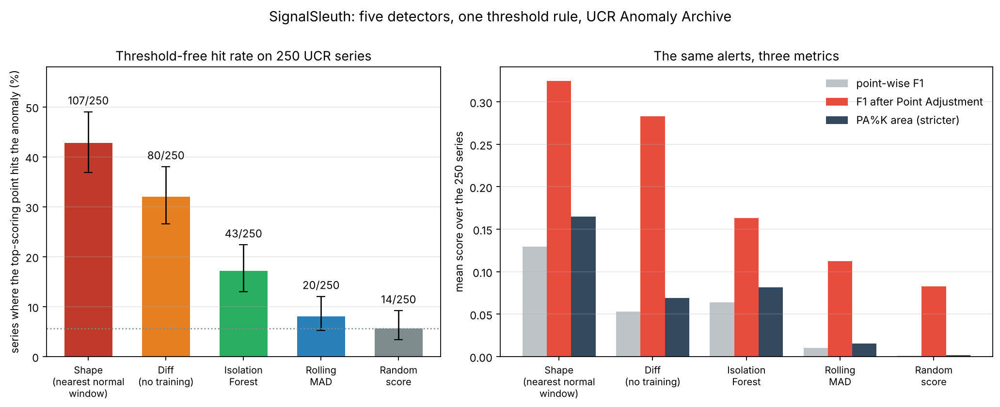
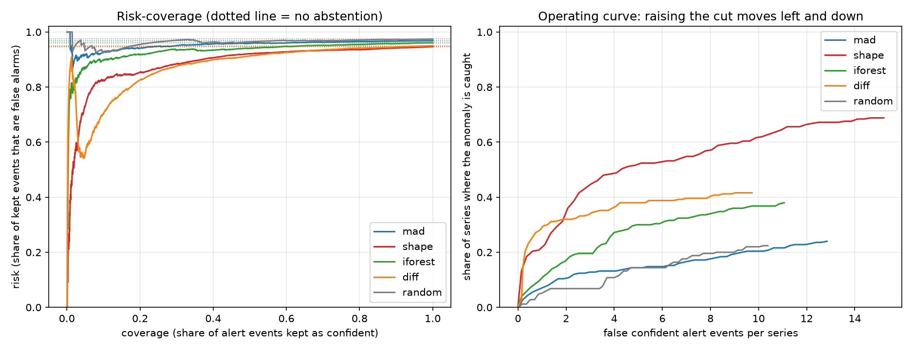
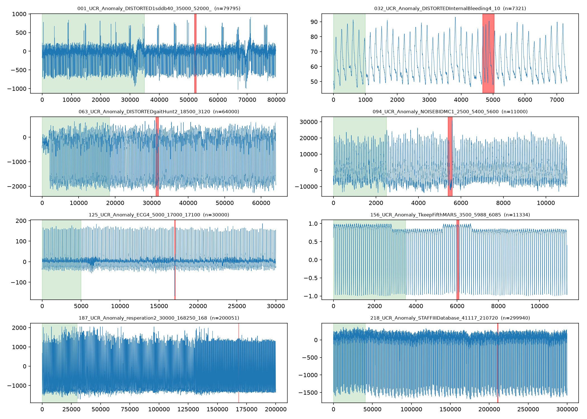
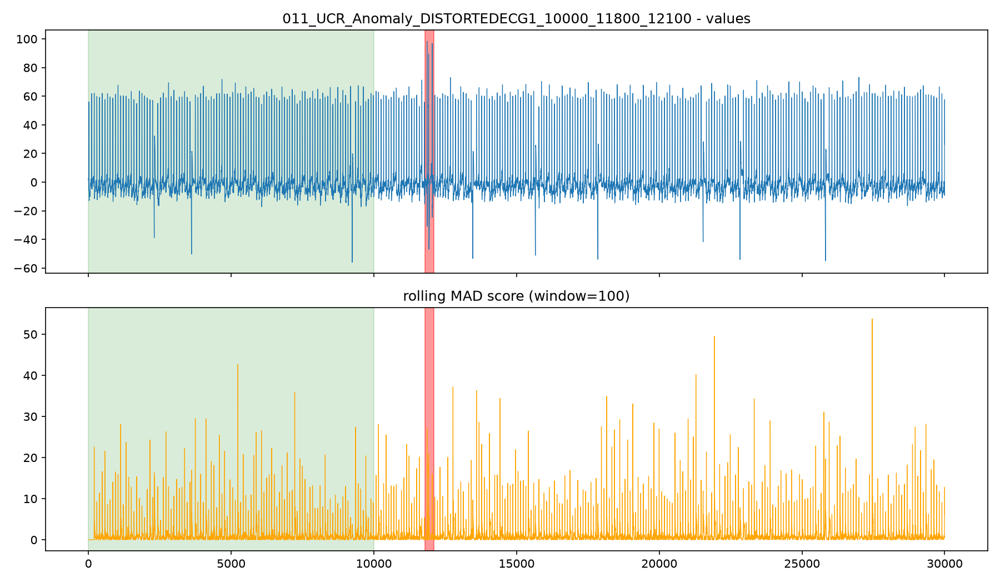
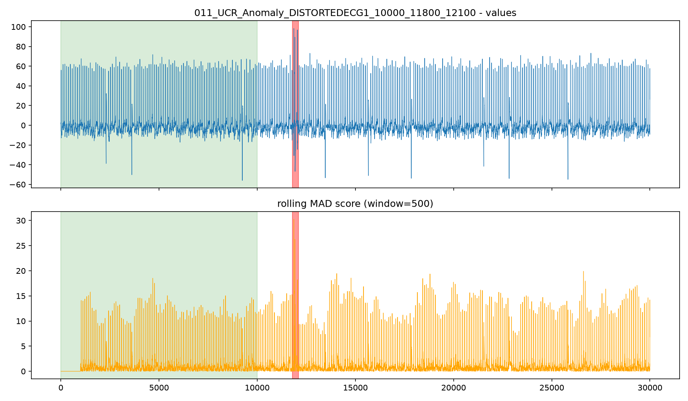

# SignalSleuth

Time-series anomaly detection, evaluated honestly. SignalSleuth compares five detectors on all 250 series of the UCR Anomaly Archive with one threshold rule, several metrics (with and without Point Adjustment), paired statistical tests, and a way for a detector to say "not sure".

**In short**

- A shape-based detector (distance to the nearest normal window) finds the anomaly in 107 of 250 series (42.8%). A training-free baseline, the absolute difference to the previous point, finds 80 (32.0%). Rolling median/MAD finds 20 (8.0%), which cannot be told apart from a random score (14, 5.6%).
- Point Adjustment makes every detector look better: a random score gets an F1 of 0.001 without it and 0.083 with it. The ranking of the detectors changes with the metric in about 31% of the series.
- Saying "not sure" removes about 90% of the false confident alerts, at a cost in caught anomalies, and it is not protection against drift.



## Problem

Published anomaly detection results depend heavily on evaluation choices: where the threshold comes from, whether Point Adjustment (PA) is used, and whether the method is compared with a trivial baseline (see Kim et al., 2022, and Wu & Keogh, 2023). This project asks:

1. Which of five detectors finds the anomaly in the UCR Anomaly Archive, under the same rules and without using test labels?
2. How much do the conclusions depend on the metric?
3. Can a detector say "not sure" instead of raising a confident alert that is wrong, and does that hold when the data drift?

## Methodology

**Detectors** (each gives one score per point; the score at time t only uses data up to t):

| Name | Idea |
|---|---|
| `shape` | Distance from a window of 100 points to its nearest window in the reference part of the train data, after z-normalising each window (so it measures shape, not height) |
| `iforest` | Isolation Forest on five features of a 100-point window (mean, std, min, max, mean absolute step) |
| `mad` | Rolling median and MAD (window 250): how far a point is from its recent median, in typical distances |
| `diff` | Absolute difference to the previous point; no training. A one-liner-style baseline in the sense of Wu & Keogh |
| `random` | Seeded noise: the chance level |

**One threshold rule for all.** The train part is split 70% / 30%: reference or training data, and calibration. The threshold is the highest score in the calibration part. Nothing from the test part and no label is used. Evaluation uses only what comes after the train part.

**Metrics.** UCR top-1 hit (the highest score after the train part lies within max(100, anomaly length) of the anomaly; needs no threshold), point-wise F1, F1 after Point Adjustment, and the area under the PA%K curve (PA applied only to segments where more than K% of the points are detected; K from 0 to 100).

**Statistics.** Wilson intervals for hit rates, bootstrap over series for means, exact McNemar test for hit / miss pairs, Wilcoxon for PA-F1 and PA%K-AUC, Holm correction over the 10 detector pairs.

**Abstention.** Alert points are grouped into events. An event is confident only if its strength (how far its peak is above the threshold, in calibration spreads) reaches a second cut. The cut is learned only from the train part: the pipeline is run on the train part alone (first 70% as "train", last 30% as "test"); every alert event there is false by construction, and the cut is the 90% quantile of their strengths, pooled over the series. The check is whether the share of real false events above the cut is close to 10%.

## Architecture

```
src/signalsleuth/
  data.py                 load_series(): reads a UCR file, train end and anomaly location come from the file name
  detectors.py            rolling median / MAD score
  advanced_detectors.py   shape detector (nearest normal window) and Isolation Forest
  baselines.py            diff and random baselines
  evaluation.py           point-wise P/R/F1, Point Adjustment, false-alarm events
  evaluation_extra.py     UCR top-1 hit, PA%K, bootstrap, McNemar, Wilcoxon
  compare.py              the five detectors under one threshold rule
  abstention.py           alert events, backtest cut, drift injection, risk-coverage
scripts/                  run_compare_250.py, analyze_compare_250.py, run_abstention.py,
                          analyze_abstention.py, make_summary_figure.py, reproduce.py, plots
tests/                    pytest suite (leakage checks, metric definitions, abstention)
reports/                  results, decisions log, literature review
figures/                  plots
```

## Dataset

The [Hexagon ML / UCR Time Series Anomaly Archive](https://www.cs.ucr.edu/~eamonn/time_series_data_2018/UCR_TimeSeriesAnomalyDatasets2021.zip) (Wu & Keogh): 250 univariate series, each with exactly one labelled anomaly. The file name carries the end of the train part and the anomaly location (`NNN_UCR_Anomaly_name_<train_end>_<start>_<end>.txt`). The data are not part of this repository.

## Experimental setup

- All 250 series, same files for every detector. Settings fixed before the runs: `mad` window 250, `shape` and `iforest` window 100, Isolation Forest seed 0, 200 trees. No tuning.
- Threshold rule and metrics as above. Failures would be recorded, not skipped (none occurred).
- Compute: the shape detector needed about 328 CPU-minutes for the 250 series; the other four together about 22.

## Results and comparisons

### 1. Detectors on 250 series

| Detector | UCR hit | 95% CI | Mean F1 | Mean PA-F1 | Mean PA%K-AUC |
|---|---|---|---|---|---|
| shape | 107/250 = 42.8% | 36.8 to 49.0 | 0.130 | 0.325 | 0.165 |
| diff | 80/250 = 32.0% | 26.5 to 38.0 | 0.053 | 0.283 | 0.069 |
| iforest | 43/250 = 17.2% | 13.0 to 22.4 | 0.064 | 0.163 | 0.081 |
| mad | 20/250 = 8.0% | 5.2 to 12.0 | 0.010 | 0.112 | 0.016 |
| random | 14/250 = 5.6% | 3.4 to 9.2 | 0.001 | 0.083 | 0.002 |

How to read the figure above. Left: the hit rate, with error bars; the dotted line is the random score. Right: the same alerts scored three ways; the red bars (after Point Adjustment) are far above the others for every detector, including the random score.

- **Shape beats the training-free baseline**: 70 series only shape found, 43 only `diff` found (McNemar p = 0.014, Holm-corrected 0.028). On the first 30 series this could not be shown (p = 0.39); the 250-series run settled it.
- **MAD is not distinguishable from random** on the hit metric (p = 0.39).
- **The conclusion depends on the metric.** Shape vs `diff`: the hit rate and PA%K-AUC separate them, PA-F1 does not (0.325 vs 0.283, Holm p = 0.44). Isolation Forest vs `diff`: `diff` is better on hit rate and PA-F1, but PA%K-AUC finds no difference. Across the 250 series, a pair of detectors is ordered the opposite way by F1 and by PA-F1 in 30.8% of the series.
- **Point Adjustment inflates scores** without better detection: `diff` goes from F1 0.053 to PA-F1 0.283; a random score reaches PA-F1 of at least 0.5 in 20 series where the hit metric says it missed. The inflation grows with the anomaly length for four of the five detectors (Spearman 0.15 to 0.33; not for `diff`). This is a correlation: long anomalies are also easier to catch.

### 2. Saying "not sure" (abstention)



Left: keep only the strongest alert events; the more events are dropped (coverage falls), the smaller the share of false alarms among those kept. The dotted lines are the share without abstention. The `diff` and shape curves fall clearly below their dotted line; MAD stays on top of the random score. Right: how many false confident alerts per series a detector needs to catch a given share of anomalies. Shape is ahead once more than about 2 false confident events per series are accepted; below that `diff` catches as many series or more.

At the 90% cut:

| Detector | False events per series | Anomaly caught (share of series) | Event precision | Share of real false events above the cut (target 0.10) |
|---|---|---|---|---|
| shape | 15.20 to 1.54 | 0.688 to 0.288 | 0.053 to 0.166 | 0.102 |
| diff | 9.73 to 0.51 | 0.416 to 0.240 | 0.050 to 0.347 | 0.053 |
| iforest | 11.06 to 0.94 | 0.380 to 0.104 | 0.039 to 0.103 | 0.085 |
| mad | 12.84 to 1.03 | 0.240 to 0.072 | 0.032 to 0.079 | 0.080 |
| random | 10.39 to 0.51 | 0.224 to 0.028 | 0.026 to 0.066 | 0.049 |

- The cut learned from the train part controls the false-alarm rate: the real share above the cut is close to or below the target.
- Abstention costs anomalies, and confident alerts are still mostly false (event precision 0.35 at best). It is a second, calibrated threshold, not a better detector.
- **Drift** (changes applied to the test part only, cuts from the clean run). MAD is not affected by a level step, a trend or a slowly growing amplitude. Isolation Forest produces 3.5 to 4.7 times more false events and 3 to 6 times more false confident alerts. `diff` fails when the amplitude grows: 102.7 false events per series instead of 9.7, and 0.458 of them pass the cut that should let 0.10 pass. So the promise is about the share of false events that become confident, not about their number. The shape detector was not tested under drift.

### 3. A single series (011)






Series 011 (30,000 points, an anomaly of 301 points) was the first real test of the rolling MAD. In the first run, with the threshold set to the highest train score, window 100 put no alert inside the anomaly and 5 outside; window 500 put 6 inside and 7 outside. This is why a shape-based detector was added.

## Limitations

- UCR only: univariate series with one labelled anomaly each. Nothing here says how the detectors behave on other benchmarks or on several anomalies per series.
- One window per detector, one seed, no tuning, one threshold rule (the highest calibration score). Point-wise F1 and PA metrics use that one threshold, and precision is low for every detector.
- The hit metric uses a tolerance of max(100, anomaly length), chosen by us.
- The archive contains several series from the same source (the file names repeat), so the series may not be independent and the intervals and p-values may be too optimistic.
- The `random` baseline uses the same seed in every series, so its scores repeat from series to series; it is a rough chance level, not an exact one.
- Abstention: the cut pools the train parts of all series; the backtest assumes the end of the train part looks like the test part; the drift tests are synthetic, with strengths chosen by us, and do not include the shape detector.
- `diff` is the core of the one-liner `abs(diff(TS)) > b` in Wu & Keogh, but their `b` was searched per series with the labels, ours comes from the calibration part.

## Future improvements

- Run the shape detector under drift (a trend is the drift that can affect it), and test a drift check based on the event rate.
- A seed per series for the random baseline; several windows per detector; a second benchmark.
- Package the project (`pyproject.toml`), log experiments in SQLite, run the tests in CI.

## Reproduce

Requirements: Python 3 and the packages in `requirements.txt`.

```bash
git clone https://github.com/ZEyad69/SignalSleuth.git
cd SignalSleuth
python -m pip install -r requirements.txt
```

Download and unzip the [archive](https://www.cs.ucr.edu/~eamonn/time_series_data_2018/UCR_TimeSeriesAnomalyDatasets2021.zip), then run everything with one command (the full run takes hours because of the shape detector; it can be stopped and restarted):

```bash
python scripts/reproduce.py <folder where you unzipped the archive>
```

A short check on 12 files takes a few minutes and writes `quick_*` files:

```bash
python scripts/reproduce.py <folder> --quick
```

Tests only:

```bash
python -m pytest -v
```

## References

- Kim, Choi, Choi, Lee, Yoon. *Towards a Rigorous Evaluation of Time-Series Anomaly Detection.* AAAI 2022. https://arxiv.org/abs/2109.05257
- Wu, Keogh. *Current Time Series Anomaly Detection Benchmarks are Flawed and are Creating the Illusion of Progress.* IEEE TKDE 35(3), 2023, pp. 2421-2429. https://arxiv.org/abs/2009.13807

The decisions behind every choice are in `reports/decisions.md`; the longer write-ups are in `reports/`.

## License

MIT, see `LICENSE`.
